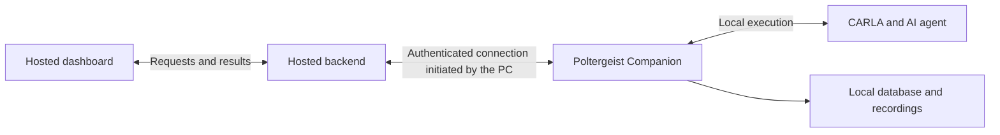

# Poltergeist roadmap: S0–S19

Status: S0 locally validated; S1–S5 have private implementations with outstanding
deployment, packaging and independent-machine gates. **S6 reliability remains
open; S7 managed model preparation is in progress.** Public S5 deployment is
deferred at the user's request. S8–S19 remain planned; early S11 design work is
already present in the S5 dashboard. See the dated
[progress notes](progress-notes.md) for current work and validation.
This roadmap records the proposed hosted dashboard/backend and
local companion architecture; it does not indicate that those services or the
production companion have been released. It is separate from the completed
[autonomous driving integration roadmap](autonomous-agents-plan.md).

Use the identifiers **S0–S19** when requesting implementation, for example
"Implement scalability phase S1", to distinguish these phases from earlier work.

## User experience and scope

The target workflow is:

1. Install a supported CARLA version and Poltergeist Companion.
2. Open the companion, locate CARLA, and pair this computer with a website account.
3. Visit the hosted dashboard and select the connected computer.
4. Configure a scenario and launch it from the website.
5. The companion starts/reuses local CARLA, executes the experiment and agent,
   and supplies progress and results to the dashboard.

Users should not need to install Python, Node.js, Git, Docker, development tools,
or pip packages manually. Poltergeist bundles a private runtime and its core
dependencies. Supported AI environments and model weights are installed through
the app as managed downloads. CARLA remains a separate installation, and the
computer still needs an operating system, graphics drivers and hardware capable
of running the selected simulator and model. Arbitrary custom models cannot be
promised universal dependency-free support.

Start with Windows x64 and CARLA 0.9.16. Validate the precise Windows versions
and hardware profiles during S1 and S10. Linux distribution follows a stable
Windows release and needs its own packaging and native validation.

## Responsibilities

| Component | Location | Responsibility |
| --- | --- | --- |
| Dashboard | Frontend hosting | Scenario forms, launch controls, selected computer, graphs, evidence and reports |
| Hosted backend | Separate application hosting | Accounts, device ownership/pairing, authorized experiment requests, relay connections and result access |
| Poltergeist Companion | User's computer | Local configuration, CARLA startup, local queue/execution, AI workers, evaluation, results and diagnostics |
| CARLA and AI agent | User's computer | Simulation, observations, inference and vehicle controls using that computer's hardware |

The companion is a new installable application, built largely from existing
Poltergeist execution code. It needs a small launcher/tray interface for pairing,
CARLA location, connection status and troubleshooting. Scenario editing and
evidence review remain in the website; a second full dashboard is unnecessary.

The current backend combines coordination, execution and storage. Split those
responsibilities deliberately: reuse `SimulationRunner`, the CARLA adapter and
launcher, agent workers, evaluation, local queue and artifact storage in the
companion. The hosted backend is an authenticated coordination service; uploading
the current local API unchanged is not this architecture.

The sensor-to-agent-to-control loop stays local. The internet connection carries
experiment commands, progress and requested evidence, not frame-by-frame driving
decisions. Each computer has independent simulation capacity. Begin with one
active run per CARLA instance and queue additional work locally.

The companion initiates an outbound encrypted connection to the hosted service.
The browser communicates with the hosted backend, so the standard workflow does
not depend on browser-to-localhost access or inbound router port forwarding.
Raw recordings stay local by default; relaying evidence is separate from
persisting it in cloud storage.

## Hosting context

The intended frontend address is <https://poltergeist.freehosting.dev/>.
`?i=1` is a query string and is not part of the site's origin or domain.
An upload build has been prepared; production deployment has not been verified.

The current InfinityFree hosting can serve the built frontend. Its free hosting
does not provide the Python runtime needed for our backend. The hosted backend
and companion relay therefore need separate application hosting. See the
[hosting support explanation](https://forum.infinityfree.com/t/does-infintyfree-support-python/117556).
Provider choice and deployment credentials are required for S4–S5, not for the
initial packaging work.

## Phases and completion gates

S0–S10 establish the core delivery and release workflow. S11–S19 are the numbered
product and agent expansion backlog added October 25, 2026. Their dependencies
can overlap earlier work: S11 design begins during S5, and S17 downloads support
S7. Numbering does not postpone usability until after release or authorize paid
provider usage or external publishing. S0 adds collision-stress calibration; S1 has a private command-line packaging prototype;
its independent clean-machine completion gate remains open. S2 has a private
desktop prototype; S3 has an installer/onboarding implementation under validation.
S4 has private account/pairing, authenticated relay and normal desktop consent
proofs. S5 has local synthetic and real CARLA website acceptance; public hosting
is deferred. S6 and S7 are in progress; S8 onward remain **planned**. Earlier phases may build
private prototypes; public remote execution requires the S4 security boundary.

Preparatory work: the current local Overview has a versioned setup-readiness
report and read-only diagnostics shared with the doctor CLI. It separates
synthetic prerequisites, CARLA client/launcher presence, explicit RPC/version
checks, and untested execution. This is a small precursor to S1 capabilities and
S3 diagnostics; it does not complete S1 packaging, define the hosted runner
boundary, or provide a companion/installer. See the S1 status below.

### S0 — Collision-stress scenarios and unchanged-baseline benchmark

**Status: implemented and locally validated.** The [collision-stress catalogue and
measurement record](collision-stress.md) contain twelve fixed presets, three per
existing family, 36 selected live calibration trials and a 60-trial held-out
baseline benchmark. The unchanged baseline had target contacts in 0/20 low,
1/20 medium and 20/20 high benchmark runs. Results are scoped to the recorded
CARLA/map/green-signal protocol; repeated seeds often resolved the same geometry.
The dashboard picker, read-only catalogue API and JSON exporter make the recipes
available without altering generic template defaults or the baseline controller.

- Create twelve usable presets across intersection, pedestrian crossing, sudden
  braking and occluded pedestrian scenarios.
- Measure their collision/near-conflict outcomes in CARLA, retain failures and
  cleanup evidence, and refine physical placement/timing using calibration seeds.
- Freeze the recipes/protocol, benchmark the unchanged default baseline on
  separate seeds, and publish per-preset outcomes and limitations.

**Complete when:** all twelve presets have valid live calibration and a recorded
baseline benchmark, with evidence for their measured danger levels, source
identity and observation/cleanup coverage. This does not validate a perception
model or establish general road safety.

### S1 — Prove packaging and define the split

**Status: partial.** The [portable prototype](portable-prototype.md) includes a
pinned private runtime/client, resources/examples, reproducible build/integrity
tooling, isolated writable profiles, a real SDK interpreter probe and the typed
[coordinator/runner v1 boundary](runner-boundary.md). This does not implement a
hosted dispatcher, public transport or installer. The separate S2 prototype adds
a companion UI; same-machine
relocation and native checks do not close the separate no-developer-tools machine
gate. Redistribution decisions and the native support matrix also remain open.
The [local validation record](s1-validation.md) records identical offline builds,
relocated synthetic/SDK checks and a short packaged CARLA comparison on the
development laptop. These results do not satisfy the independent-machine gate.

- Define versioned boundaries between the hosted coordinator and local runner,
  including device capabilities and existing features that remain local.
- Prototype a private Python 3.12 runtime with the matching CARLA client, core
  libraries, templates and packaged resources. Avoid dependence on the user's
  `PATH`, repository checkout or development environment.
- Verify SDK subprocess startup with the packaged interpreter; freezing a launcher
  must not accidentally launch that launcher again as an agent worker.
- Identify native libraries, redistribution terms and supported platform limits.

**Complete when:** a machine without developer tools can run a packaged synthetic
experiment, a short CARLA baseline experiment and an SDK worker smoke check.

### S2 — Build Poltergeist Companion

**Status: private prototype.** The [desktop guide](companion.md) describes the
native window, existing durable queue/agent/evaluation/storage reuse, isolated
profile, instance lock, configuration, diagnostics and explicit JSON import/export
path. Hosted connection status remains unavailable until S4/S5. The independent
S1 machine gate, supported native platform matrix and distribution terms remain
open; this is not a supported public desktop release.

- Create the desktop launcher/tray application and reuse the existing local
  execution engine, CARLA launcher, queue, agent support, evaluation and storage.
- Provide start/stop, connected/disconnected status and diagnostic access.
- Put settings, logs, databases and recordings in per-user application data
  directories. Any internal HTTP service binds to loopback and requires local
  authorization; retain a single companion instance per user/profile.
- Preserve existing development workflows and provide an explicit existing-data
  import path rather than silently relocating the user's repository storage.

**Complete when:** double-clicking the companion starts the local runtime, executes
an experiment and preserves its results after restarting the application.

### S3 — Installer and first-run setup

**Status: private prototype locally validated; external gate open.** A pinned per-user Windows installer,
native dependency checks, first-run CARLA discovery/configuration, explicit
startup and version/map checks, opt-in login startup, offline repair and
data-preserving uninstall are implemented. Same-laptop installer tests cover
synthetic and short live CARLA execution, persistence, clean repair, shortcuts and
ownership-aware profile removal.
The [installer guide](installer-onboarding.md) records the build and validation
scope. The external tester gate below remains open.

- Build an installer with shortcuts, repair and uninstall support; make optional
  login startup a user choice.
- Add a wizard to detect/browse for CARLA, check client/server compatibility,
  inspect hardware and disk space, and configure maps and Low/Epic graphics.
- Turn actionable installation failures into readable UI messages, without
  requiring `.env` edits or terminal commands.
- Keep user data across repairs and offer an explicit preservation choice during
  uninstall. Include all required core dependencies in the release package.

**Complete when:** an external tester installs CARLA and the companion and runs
the supported local workflow without Python, Node.js, Git, Docker or pip setup.

### S4 — Hosted backend, accounts and secure pairing

- Build account authentication, device identities, ownership and short-lived
  pairing codes approved on the user's computer.
- Add authenticated outbound companion connections, credential storage,
  revocation and narrowly defined command permissions.
- Use typed, allowlisted operations, not a general shell or filesystem proxy.
  Local package/model selection and agent execution require device-side approval.
- Keep hosted account/device metadata separate from each PC's SQLite database.
  Never expose the current trusted local agent API as an unauthenticated public API.

**Complete when:** an owner can pair/control their computer, revoke access, and
demonstrate that another account cannot read its data or submit work to it.

### S5 — Hosted dashboard and companion integration

- Extend the frontend API/transport layer to target a selected paired device
  through the hosted backend while preserving current local development mode.
- Add download/open companion, pair/connect computer, device selection,
  availability and capability/version compatibility UI.
- Keep scenario creation, execution controls, agent selection and result review
  in the website. The companion supplies local setup and status, not duplicate pages.
- Deploy the production frontend at the chosen domain and configure HTTPS and the
  hosted API connection. Define behavior when the companion is closed or outdated.

**Complete when:** a user visits the actual HTTPS website, pairs their computer,
launches local CARLA and reviews a completed baseline experiment through the site.

### S6 — Reliable delivery, execution ownership and reconnection

- Add durable command/job identifiers, acknowledgements, idempotency and bounded
  retries so a lost response cannot launch an experiment twice.
- Reconcile remote status with the local durable queue after reconnecting.
  Protect one tick owner per CARLA endpoint, including across local profiles.
- Define cancellation ordering and behavior for browser closure, network loss,
  companion exit, PC sleep and crashes. Disconnected running jobs may finish
  locally; native runs interrupted by process loss must be reported explicitly.
- Retain completed results for later synchronization; do not claim exactly-once
  delivery or successful cancellation merely because a message was sent.

**Complete when:** fault tests show no duplicate execution, cross-device queue
mixups or false completion after disconnect/restart, and cancellations reconcile.

### S7 — App-managed AI environments and model packs

**Status: in progress.** The Companion prepares revision-pinned PlanT weights
with resumable HTTPS transfer and, in model-pack builds, installs a separate
hash-verified CPU interpreter/dependency generation. Environment checks execute
two synthetic inference fixtures before trusted registration through the Agent
selector. Repair/removal respect active workers and saved model jobs. Live packaged
CARLA execution, fresh-machine acceptance, native hardware/path coverage and full
redistribution review remain open. See [managed AI preparation](managed-ai.md).

- Provide managed baseline/starter and reference AI choices, starting with PlanT.
- Keep agent dependency environments separate from the companion's core runtime.
  Pin supported versions and verify downloaded packages and model weights.
- Add resumable downloads, size/progress information, compatibility checks,
  licensing notices and removal/repair controls.
- Define the supported custom-agent dependency contract and retain local trust
  approval; installing an arbitrary package is not a sandbox for untrusted code.

**Complete when:** a fresh supported computer can prepare and execute the reference
AI through the app without manual interpreter or dependency installation.

### S8 — Results, recordings and bandwidth management

- Send summaries/progress first; page telemetry and retrieve sensor samples only
  when the user requests them. Keep AI observations local during execution.
- Stream large evidence with authorization, integrity checks, cancellation,
  backpressure and transfer limits rather than buffering whole recordings.
- Add local disk quotas, retention, export and explicit optional cloud sharing.
  Define cloud retention/deletion if cloud storage is enabled.
- Distinguish disconnected devices, unavailable local files and actual deletion
  in evidence review. Preserve exact recorded frame references and unknowns.

**Complete when:** long captured experiments can be reviewed without uncontrolled
uploads, memory growth or inaccessible evidence being presented as a valid zero.

### S9 — Multi-user service capacity and operations

- Measure and agree on initial connected-device, active-run and transfer targets.
- Add hosted monitoring, request limits, per-user/device quotas and routing.
  Expand relay instances and shared connection routing when measurements require it.
- Keep each user's execution queue and CARLA workload independent; do not share
  one writable local SQLite database between cloud workers or users.
- Load-test the service with simulated companions, and validate real execution
  on representative physical PCs. Measure cloud traffic/storage costs separately
  from local GPU and inference performance.

**Complete when:** measured service targets are met with correct ownership and
routing, bounded resource use and no interference between users' devices.

### S10 — Signed releases, updates and external beta

- Automate repeatable builds and signed installer/update distribution, version
  negotiation, integrity checks, migration backups and rollback procedures.
- Apply updates at safe points, preserving active runs, local results and recorded
  agent identities. Keep compatible older companions usable during staged rollout.
- Test clean installations, upgrades, repair/uninstall, different CARLA paths,
  graphics settings, hardware profiles and failure recovery on external PCs.
- Begin with a small private beta, publish the tested support matrix and setup
  guide, then increase availability based on measured stability and capacity.

**Complete when:** external users can install, pair, execute, review evidence,
update and troubleshoot without repository access or developer assistance.

### S11 — Visual design and usability

- Establish a consistent dashboard and companion design, typography, themes,
  responsive charts/layouts and readable device/experiment status.
- Complete loading, empty, offline, error and recovery states; support keyboard
  navigation and accessible contrast, labels and focus behavior.

**Complete when:** principal workflows pass visual/accessibility review and
first-run testing on supported desktop displays and phone viewport sizes.

### S12 — Guided experimentation and adoption

- Guide a first experiment with an illustrated scenario gallery and clear next
  actions; add saved experiment suites, useful comparisons and replay highlights.
- Make results and exports understandable and collect deliberate tester feedback
  about confusing steps and reasons to return.

**Complete when:** new testers can run an experiment and explain its recorded
outcome without assistance, with feedback driving verified usability changes.

### S13 — Failure Discovery Agent

- Translate an evaluation goal into a validated experiment plan using typed,
  allowlisted operations and user-approved execution/time budgets.
- Search with supported local agents, repeat candidate failures, retain failed
  trials and return reproducible scenarios with measured outcomes.

**Complete when:** a bounded plan produces reproducible confirmed failures or
honestly reports that no failure was confirmed, with a complete trial record.
Depends on S6–S8; an optional language interface comes from S18.

### S14 — Evidence Analyst Agent

- Summarize recorded contacts, braking and interventions with exact frame links
  and measurement coverage, keeping observations and hypotheses distinct.
- Identify missing evidence and avoid inventing model reasoning or causal claims
  from a collision or replay alone.

**Complete when:** reviewed analyses trace factual claims to recorded evidence
and preserve unknowns on incomplete or unavailable runs. Depends on S8.

### S15 — Regression Agent

- Compare frozen model versions on matched saved recipes and seeds, recording
  input/execution differences, sample counts, uncertainty and incomplete results.
- Flag measured regressions and retain reproducible suites and evidence.

**Complete when:** repeatable comparisons identify introduced regressions and
explain inconclusive outcomes without turning missing coverage into a good score.
Depends on reliable execution, managed agents and evidence; S19 adds CI reporting.

### S16 — Sensor-based driving agents

- Integrate supported trained camera/LiDAR driving policies through the existing
  agent worker, validating real sensor inputs and actual model vehicle control.
- Verify dependencies, weights, licenses and hardware timing independently of
  the existing object-centric PlanT integration.

**Complete when:** a supported sensor policy runs through the app on documented
hardware with verified inputs/control, bounded timing and reproducible results.
Depends on S7 and S8; this does not imply general road-safety validation.

### S17 — Hugging Face integration

- Add curated revision-pinned model downloads supporting S7, with verified
  hashes/licenses, caching, progress and bounded resumable transfer.
- Handle interrupted downloads, insufficient storage, repair and removal while
  respecting model access requirements and explicit account configuration.

**Complete when:** supported model assets can be acquired, verified, resumed and
removed through the app without manual weight-file management.

### S18 — OpenAI integration

- Offer an optional natural-language interface for discovery planning and
  evidence analysis through validated, bounded Poltergeist tools.
- Require explicit provider configuration and usage budgets; send only selected
  evidence and independently check factual claims and coverage.

**Complete when:** assistant workflows respect account/device permissions,
execution and usage limits, decline unsupported actions and produce reviewable
plans and evidence-linked reports. Supports S13–S14; no arbitrary shell access.

### S19 — GitHub integration

- Associate regression results with exact model commits and expose reliable
  report/check status mappings for reviewed experiment suites.
- Define app/token permissions, private-evidence disclosure and explicit
  publishing authorization; preserve incomplete/failed validation states.

**Complete when:** an authorized workflow attaches a reproducible regression
summary to the correct revision and check, without disclosing unselected private
evidence. Depends on S15 and appropriate repository access.

## Milestones and user involvement

| Milestone | Required phases | Result |
| --- | --- | --- |
| Installable local companion | S1–S3 | CARLA plus one Poltergeist installer, with no manual developer setup |
| Hosted baseline workflow | S4–S6 | Website account controls a paired local computer reliably |
| Supported AI and evidence workflow | S7–S8 | Managed reference model and practical recording/result delivery |
| Wider distribution | S9–S10 | Measured service capacity, updates and externally validated release |
| Product quality and adoption | S11–S12 | Accessible, polished workflows and guided repeat use |
| Experiment intelligence | S13–S16 | Discovery, analysis, regression and supported sensor policies |
| External integrations | S17–S19 | Managed model acquisition, optional language assistance and authorized CI reporting |

Development and automated testing can proceed within each phase. The owner needs
to provide hosting/account access for deployment, signing credentials for public
releases, decisions about optional cloud retention/costs, and external testers
with representative computers. Testing on the development machine alone cannot
establish installer portability or a hardware support matrix.
